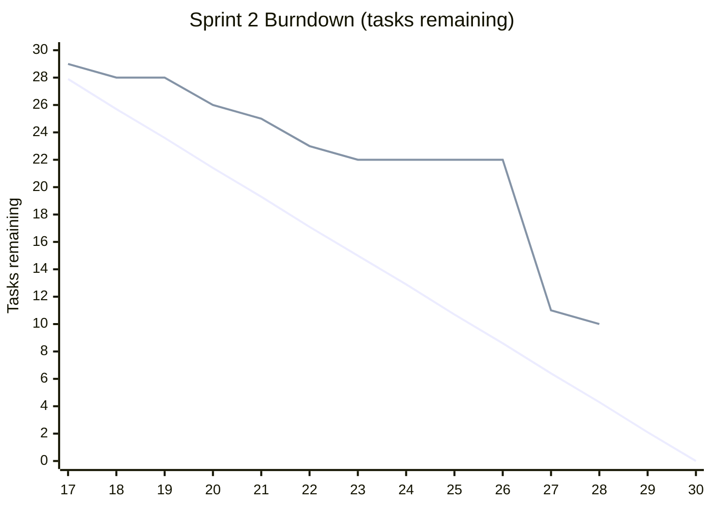

# Sprint 2 Velocity and Burndown

**Task ID:** S2-SM-04

**Owner:** Jixell Massey Ogbinar (Scrum Master)

**Sprint:** 2 (Customer and Product modules)

**Data as of:** November 28, 2026, from merges to `main`

## 1. How This Is Measured
- **Unit:** one task (one issue on the board). The team does not use story points, so every
  task counts as 1.
- **Done:** the task's PR is merged to `main` (our Definition of Done).
- **Date:** the date the PR that finished the task was merged.
- **Sprint start:** November 17, 2026. **Sprint end:** not set yet. The ideal line below
  assumes the planned two-week length (end November 30), so it drops by about 2.1 tasks
  per day from 30. Both lines show tasks remaining at the end of each day. Update it once the end date is
  confirmed.

## 2. Velocity

### By sprint

| Sprint | Planned | Merged | Velocity |
| --- | --- | --- | --- |
| Sprint 1 | 30 | 30 | 30 |
| Sprint 2 (so far) | 30 | 20 | 20 as of Nov 28 (23 once SM-03 to SM-05 merge) |

### By role

| Role | Sprint 1 merged | Sprint 2 planned | Sprint 2 merged | Sprint 2 open |
| --- | --- | --- | --- | --- |
| Developer | 8 of 8 | 8 | 1 | 7 |
| DB Admin | 6 of 6 | 6 | 6 | 0 |
| Tester | 6 of 6 | 6 | 6 | 0 |
| UI/UX Designer | 5 of 5 | 5 | 5 | 0 |
| Scrum Master | 5 of 5 | 5 | 2 | 3 |
| **Team** | **30** | **30** | **20** | **10** |

The team's total is lower than in Sprint 1 because of one role: Developer. Every other
role has finished or is about to finish its planned work.

## 3. Burndown

### Tasks finished per day

| Date | Merged that day | Tasks | Remaining (end of day) | Ideal |
| --- | --- | --- | --- | --- |
| Nov 17 | Customer wireframe (#117) | 1 | 29 | 27.9 |
| Nov 18 | TST-01 customer test cases (#119) | 1 | 28 | 25.7 |
| Nov 19 | None | 0 | 28 | 23.6 |
| Nov 20 | Product wireframe (#121), UIX-03 hi-fi mockups (#123) | 2 | 26 | 21.4 |
| Nov 21 | UIX-04 empty, error and confirm-delete states (#124) | 1 | 25 | 19.3 |
| Nov 22 | SM-01 planning notes (#132), SM-02 retro follow-up (#133) | 2 | 23 | 17.1 |
| Nov 23 | UIX-05 usability review (#134) | 1 | 22 | 15.0 |
| Nov 24 | None | 0 | 22 | 12.9 |
| Nov 25 | None (README edit #135, not a sprint task) | 0 | 22 | 10.7 |
| Nov 26 | None | 0 | 22 | 8.6 |
| Nov 27 | DBA-01 to DBA-06 (#136 to #147), TST-02 to TST-06 (#144 to #160) | 11 | 11 | 6.4 |
| Nov 28 | DEV-01 customer list with search and filter (#162) | 1 | 10 | 4.3 |
| Nov 29 |  |  |  | 2.1 |
| Nov 30 |  |  |  | 0.0 |

### Chart

The first line is the ideal pace and the second is actual. If the chart does not render,
use the table above.

## 4. What the Burndown Shows
- **Flat line from Nov 23 to Nov 26.** No sprint tasks merged for four days.
- **One big drop on Nov 27.** 11 tasks merged in one day. The work was done earlier, but
  it reached `main` late, so the board looked behind for most of the sprint.
- **The DB tasks merged late, which held the Developer back.** The planning notes said
  DBA-01 and DBA-03 must come first to unblock DEV-01 to DEV-06, and they only merged on
  Nov 27. DEV-01 followed the next day.
- **10 tasks remain:** DEV-02 to DEV-08 and SM-03 to SM-05. Even after the SM documents
  merge, 7 Developer tasks are left, so the sprint will not reach zero by Nov 30.

## 5. Forecast and Advice for Sprint 3
- **Plan per role, not just a team total.** The team can do about 30 tasks per sprint,
  but one role at 1 of 8 holds back the whole sprint goal. Sprint 3 (HR) should give the
  Developer the same number of tasks or fewer, broken into smaller pieces.
- **Finish blocking tasks in the first two days.** DB views, constraints and handoffs that
  the Developer needs should merge by day 2.
- **Merge small and often.** Open a PR as soon as one task is done so the burndown moves
  every day and problems are seen early.
- **Carry over unfinished DEV tasks** into Sprint 3 at the top of the backlog if Sprint 2
  ends before they are merged.
