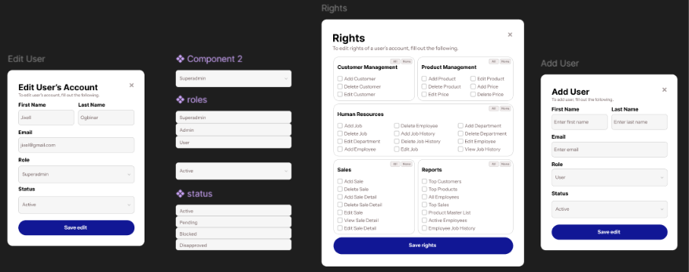

# [S1-UIX-04] Hi-fi mockups (login, register, main page, User Management, Rights dialog)

Hi-fi mockups for Login, Register, Main Page (Dashboard), User Management, Edit/Add User, and the Rights dialog of **Tiramis-u, Inc. ERP**.

.png>)

## Screens

| # | Screen | Purpose |
|---|--------|---------|
| 1 | Login (modal) | Sign in with email/username + password, or Continue with Google. Links to Register and Forgot password. |
| 2 | Register (modal) | Create an account: username, email, password, confirm password, or Continue with Google. |
| 3 | Main page (Dashboard) | Welcome banner and four stat cards: Total Customers, Total Revenue, Products, Open orders. |
| 4 | User Management | Table of users with role/status pills and per-row actions. Admin/Superadmin only. |
| 5 | Edit User's Account (modal) | Edit first name, last name, email, role, status. |
| 6 | Add User (modal) | Same form as Edit, empty fields, role defaults to User. |
| 7 | Rights (modal) | Per-user permission checkboxes grouped by module. |

## Layout

- **Navbar:** logo "T" + "Tiramis-u, Inc. ERP", sidebar toggle icon, page title, user chip (shows role name for Admin/Superadmin, "Google User" for Google sign-in), logout icon.
- **Sidebar:** Dashboard, User Management, Human Resources, Customers, Products, Sales, Reports. Each item is a rounded outlined button with an icon and a chevron. The active item is filled. Sidebar can be collapsed with the toggle.
- **Content:** dark background; cards and the user table sit on slightly lighter navy panels with rounded corners.

## Style

| Token | Value |
|-------|-------|
| Font | Inter |
| Page background | `#0b0d17` |
| Sidebar / panels | `#0f1322`, `#10142a`, `#151929` |
| Borders | `#1e293b`, `#1a2035` |
| Primary button (modals) | `#14198c` |
| Modal background | white, inputs `#f1f2f6` |
| Role pill: Superadmin | gold `#c5b34a` |
| Role pill: Admin | green `#22a455` |
| Role pill: User | dark blue `#2b3a7a` |
| Status pill: Active | green `#22a455` |
| Status pill: Pending | lime `#b7c04b` |
| Status pill: Blocked / Disapproved | red `#d02b3a` |
| Approve button | green; Disapprove button: dark red `#a31622` |

## Access rules

- **User** (including Continue with Google): sees **Dashboard only**. Other sidebar tabs are hidden.
- **Admin / Superadmin:** see all sidebar tabs. Dashboard and User Management are built; the other tabs are placeholders for now.

## User Management

Columns: **Name, Email, Role, Status, Actions.**

Actions shown per row:

| Condition | Buttons |
|-----------|---------|
| Status Pending | Approve, Disapprove |
| Status Active (not the first Superadmin row) | Block |
| Status Blocked | Unblock |
| Role User | Rights |
| Every row | Edit |

- **Approve / Unblock** sets status to Active; **Block** sets Blocked; **Disapprove** sets Disapproved.
- **+ Add User** opens the Add User modal.

Roles: Superadmin, Admin, User. Statuses: Active, Pending, Blocked, Disapproved.

## Forms and validation

**Login:** both fields required.

**Register:** username min 3 characters; valid email; password min 8 characters; confirm password must match.

**Forgot password flow:** email → 6-digit code → new password (min 8, must match) → back to login.

**Add / Edit User:** first name, last name and a valid email are required. Role and status are dropdowns.

## Rights dialog

Checkbox groups, each with **All** and **None** buttons:

- **Customer Management:** Add Customer, Delete Customer, Edit Customer
- **Product Management:** Add Product, Delete Product, Edit Price, Edit Product, Add Price, Delete Price
- **Human Resources:** Add Job, Delete Job, Edit Department, Add Employee, Delete Employee, Add Job History, Delete Job History, Edit Job, Add Department, Delete Department, Edit Employee, View Job History
- **Sales:** Add Sale, Delete Sale, Add Sale Detail, Delete Sale Detail, Edit Sale, View Sale Detail, Edit Sale Detail
- **Reports:** Top Customers, Top Products, All Employees, Top Sales, Product Master List, Active Employees, Employee Job History